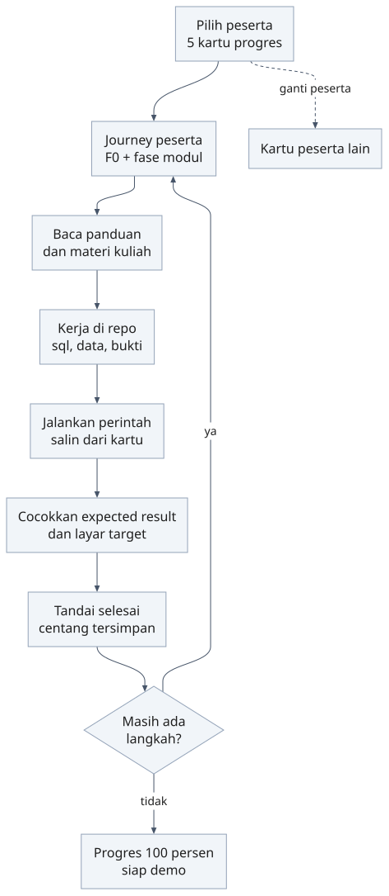

# Web Tutor Klinik Pratama

Tutor interaktif untuk tim UAS Konsep Basis Data. Lima peserta memilih kartunya sendiri, lalu mengikuti journey langkah demi langkah: baca panduan, tulis modul SQL, jalankan perintah, dan cocokkan keluaran dengan expected result. Progres centang disimpan di browser, jadi bisa dilanjutkan kapan saja.

Aplikasi ini hanya berisi materi dan penanda progres; tidak menjalankan MySQL dan tidak mengubah repo kerja.

**Live:** https://tutor-klinikpratama.yyypluto.my.id/

## Daftar Isi

- [Features](#features)
- [Requirements](#requirements)
- [Install](#install)
- [Usage](#usage)
- [Reading the fields](#reading-the-fields)
- [What it reads and touches](#what-it-reads-and-touches)
- [Architecture](#architecture)
- [Development](#development)
- [Deploy (Cloudflare Workers)](#deploy-cloudflare-workers)
- [SEO dan pratinjau tautan](#seo-dan-pratinjau-tautan)
- [Troubleshooting](#troubleshooting)
- [Security notes](#security-notes)
- [License](#license)

## Features

- Lima kartu peserta (A1–A5) berisi role, branch, level, dan cincin progres.
- Journey 16 langkah per peserta: F0 fondasi bersama, lalu fase modul masing-masing.
- Tiap langkah memuat materi kuliah, bahan bacaan, langkah kerja, perintah siap salin, expected result, dan bukti selesai.
- Centang langkah berurutan; langkah berikutnya terbuka setelah yang sekarang selesai.
- Progres dan tema tersimpan di `localStorage`, tanpa akun.
- Sembilan layar target berupa SVG: reset database, struktur tabel, verifikasi 34 pemeriksaan, view/trigger, prosedur, hak akses, EXPLAIN, sepuluh skenario uji, dan laporan.
- Theme terang/gelap, pintasan `1`–`5` di halaman pilih, `Esc` untuk kembali.
- Responsif: tiga kolom di desktop, satu kolom dengan drawer langkah/info di ponsel.
- Reset progres per peserta lewat dialog konfirmasi.

## Requirements

- Bun 1.3+ — satu-satunya toolchain: install, dev, build, lint, smoke, dan wrangler lewat `bun`/`bunx`. Node/npm tidak dipakai.
- Browser modern (Chromium, Firefox, Safari) dengan dukungan `dialog` dan `startViewTransition` opsional

## Install

1. Pastikan Bun tersedia.
   ```bash
   bun --version
   ```
2. Masuk ke folder aplikasi.
   ```bash
   cd Web-Tutor-KlinikPratama
   ```
3. Pasang dependensi.
   ```bash
   bun install
   ```
4. Izinkan postinstall tema Astryx (hanya bila Bun memblokirnya).
   ```bash
   bun pm trust @astryxdesign/core
   ```
5. Jalankan server pengembangan.
   ```bash
   bun run dev
   ```
6. **Verify it loaded:** buka `http://localhost:5185/`, halaman harus menampilkan judul "Pilih peserta, ikuti journey, cocokkan hasil SQL." dan lima kartu A1–A5.

## Usage

Alur harian:

1. Di halaman pilih, klik kartu peserta (atau tekan `1`–`5`).
2. Baca panel detail dari atas: materi, tautan panduan, langkah kerja.
3. Salin perintah dengan tombol **Salin**, jalankan di terminal, bandingkan hasil dengan kartu expected result.
4. Tekan **Tandai selesai** bila keluaran cocok. Aplikasi otomatis pindah ke langkah berikutnya.
5. Klik thumbnail **Layar target** untuk melihat contoh keluaran ukuran penuh (panah kiri/kanan, `Esc` menutup).
6. Kembali ke daftar peserta lewat **Pilih peserta** atau `Esc`.

Aksi yang tersedia:

| Aksi | Lokasi | Efek |
|---|---|---|
| Pilih kartu peserta | Halaman pilih | Membuka journey peserta, langkah pertama yang belum selesai |
| `1`–`5` | Halaman pilih | Memilih peserta sesuai urutan kartu |
| Tandai selesai | Panel detail | Menyimpan centang, membuka langkah berikutnya |
| Batalkan centang | Panel detail | Menghapus centang; langkah sesudahnya ikut terkunci lagi |
| Langkah sebelumnya / berikutnya | Panel detail | Pindah langkah tanpa mengubah centang |
| Salin | Blok perintah | Menyalin perintah ke clipboard |
| Theme | Kanan atas | Berganti terang ↔ gelap, tersimpan |
| Reset progres | Kanan atas | Dialog konfirmasi, menghapus centang peserta itu |
| Langkah / Info | Kepala journey di ponsel | Membuka drawer timeline atau konteks peserta |

Persen di halaman pilih dihitung dari jumlah centang dibagi 16 langkah peserta tersebut. Kartu A1–A5 di halaman pilih bersifat navigasi, bukan tombol aksi.

## Reading the fields

| Field | Arti |
|---|---|
| `0%` / `16/16` | Progres centang peserta, dihitung dari `localStorage` |
| `Level Awal` / `Level Menengah` | Perkiraan beban fase modul |
| `Branch anggota-N/...` | Branch kerja peserta di repo UAS |
| `F0`–`F5` | Fase proyek: fondasi, skema, data, objek, uji, rilis |
| `F0 · Fondasi repo` | Fase fondasi wajib untuk semua peserta |
| Dot terisi / kosong | Langkah sudah / belum dicentang |
| Judul langkah redup + border putus-putus | Langkah terkunci; masih bisa dibaca, belum bisa dicentang |
| `Materi kuliah` | Pertemuan yang relevan untuk langkah itu |
| `Baca dulu` | Berkas di repo kerja atau panduan anggota |
| `Perintah` | Perintah terminal/SQL siap salin |
| `Expected result` | Keluaran yang harus muncul |
| `Layar target` | Gambar contoh keluaran; klik untuk memperbesar |
| `Bukti selesai` | Bukti yang perlu disimpan sebelum menandai selesai |

## What it reads and touches

- Membaca `localStorage` kunci `klinik-tutor-v1` untuk `done` dan `theme`.
- Membaca aset lokal di `public/assets/screens/*.svg` dan `public/favicon.svg`.
- Tidak ada backend, request jaringan keluar, cookie, atau akun.
- Tombol **Salin** memakai Clipboard API; bila ditolak browser, tombol tetap memberi umpan balik tanpa menyalin.

## Architecture

```
Web-Tutor-KlinikPratama/
├── index.html               # kerangka halaman
├── package.json             # skrip dev/build/lint/smoke
├── vite.config.js           # port 5185
├── wrangler.jsonc           # deploy Cloudflare Workers + dist sebagai aset
├── biome.json               # lint dan format
├── public/
│   ├── favicon.svg
│   └── assets/screens/      # sembilan layar target SVG
├── scripts/
│   ├── make-screens.mjs     # membuat ulang aset layar
│   └── smoke.mjs            # smoke test produksi
├── docs/
│   ├── klinik-flow.mmd      # sumber diagram alur
│   ├── klinik-flow.svg      # hasil kompilasi
│   └── build-flow.sh        # kompilasi + warna literal
└── src/
    ├── main.jsx             # mount React, impor tema
    ├── App.jsx              # picker, journey, dialog, drawer
    ├── app.css              # token Astryx + komposisi
    ├── icons.jsx            # ikon garis
    ├── theme.js             # tema netral Astryx
    └── data/journey.js      # 5 peserta, 16 langkah per journey (64 total)
```



Data mengalir satu arah: `journey.js` → komponen React → DOM; centang ditulis ke `localStorage` lewat satu fungsi `save`, lalu dibaca ulang saat aplikasi dimuat.

## Development

| Perintah | Fungsi |
|---|---|
| `bun run dev` | Server pengembangan di port 5185 |
| `bun run build` | Bundel produksi ke `dist/` |
| `bun run preview` | Sajikan hasil `dist/` |
| `bun run lint` | Biome check tanpa menulis |
| `bun run check` | Biome check + perbaikan otomatis |
| `bun run smoke` | Build, jalankan preview, periksa halaman, bundel, dan aset |
| `bun run deploy` | Deploy `dist/` ke Cloudflare Workers (butuh login wrangler) |
| `bun run cf:preview` | Sajikan `dist/` lewat runtime Workers lokal |
| `bun scripts/make-screens.mjs` | Membuat ulang sembilan SVG layar target |
| `bash docs/build-flow.sh` | Kompilasi diagram alur lewat Bun (butuh Git Bash) |

Konten journey berada di `src/data/journey.js`. Menambah langkah berarti menambah objek `{ id, title, baca, kerja, expected, bukti }` di fase yang sesuai; ID harus unik karena dipakai sebagai kunci progres.

## Deploy (Cloudflare Workers)

`wrangler.jsonc` menyajikan `dist/` sebagai aset statis dengan fallback SPA.

1. Build lokal dan cek hasilnya.

   ```bash
   bun run build
   bun run cf:preview
   ```

   Buka `http://127.0.0.1:8787/`; halaman, `/assets/screens/*.svg`, dan URL dalam aplikasi harus 200.

2. Login sekali di mesin ini.

   ```bash
   bunx wrangler login
   ```

3. Deploy.

   ```bash
   bun run deploy
   ```

Di dashboard Cloudflare (Settings → Build), isi:

| Isian | Nilai |
|---|---|
| Build command | `bun run build` |
| Deploy command | `bunx wrangler deploy` |
| Preview command | `bunx wrangler dev` (bukan `wrangler preview`; perintah itu dihapus di wrangler 4) |
| Root directory | isi repo |

Nama Worker mengikuti `name` di `wrangler.jsonc`, jadi ubah di sana bila nama proyek berbeda.

Domain produksi: https://tutor-klinikpratama.yyypluto.my.id/ — custom domain Worker yang dipasang di dashboard Cloudflare (Workers & Pages → Worker → Settings → Domains & Routes), bukan di `wrangler.jsonc`.

## SEO dan pratinjau tautan

- `index.html` memuat canonical, meta `og:*` lengkap, `twitter:summary_large_image`, dan JSON-LD `WebSite`.
- Gambar pratinjau: `public/og-cover.png` (1500x788, ambil dari tampilan pilih peserta).
- `public/robots.txt` mengizinkan crawl dan menunjuk `sitemap.xml`; sitemap berisi satu URL produksi.
- URL kanonik memakai https://tutor-klinikpratama.yyypluto.my.id/ — ganti di ketiga tempat (index, robots, sitemap) bila domain berubah.

## Troubleshooting

| Gejala | Sebab | Perbaikan |
|---|---|---|
| Port 5185 sudah dipakai | Proses dev lain masih hidup | Hentikan proses itu atau ubah `server.port` di `vite.config.js` |
| Halaman putih setelah `bun install` | Postinstall Astryx diblokir | Jalankan `bun pm trust @astryxdesign/core` lalu ulangi `bun run dev` |
| Progres kembali 0 | `localStorage` dibersihkan atau mode privat | Pakai jendela normal; centang ulang |
| Thumbnail layar kosong | Aset belum ada atau path salah | Jalankan `bun scripts/make-screens.mjs` |
| `bun run smoke` gagal di port 5186 | Port preview bentrok | Hentikan proses preview lain |
| Diagram alur tidak berubah | SVG lama belum dikompilasi ulang | Jalankan `bash docs/build-flow.sh` |
| Deploy gagal dengan error autentikasi | Wrangler belum login di mesin ini | Jalankan `bunx wrangler login` lalu ulangi `bun run deploy` |

## Security notes

- Aplikasi statis tanpa server; tidak ada data pengguna yang dikirim keluar.
- Progres hanya tersimpan lokal di browser dan bisa dihapus lewat reset progres.
- Konten perintah berasal dari repo UAS dan panduan internal; tidak ada eksekusi otomatis dari aplikasi.
- Tidak ada elemen pihak ketiga, analitik, atau iframe.

## License

Materi internal untuk tugas UAS Konsep Basis Data. Tidak dipublikasikan sebagai paket.
